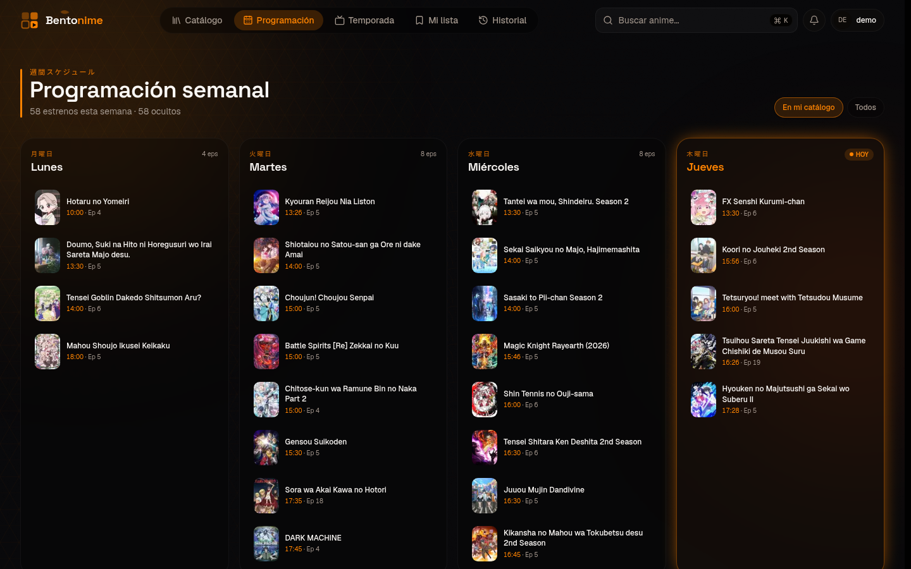
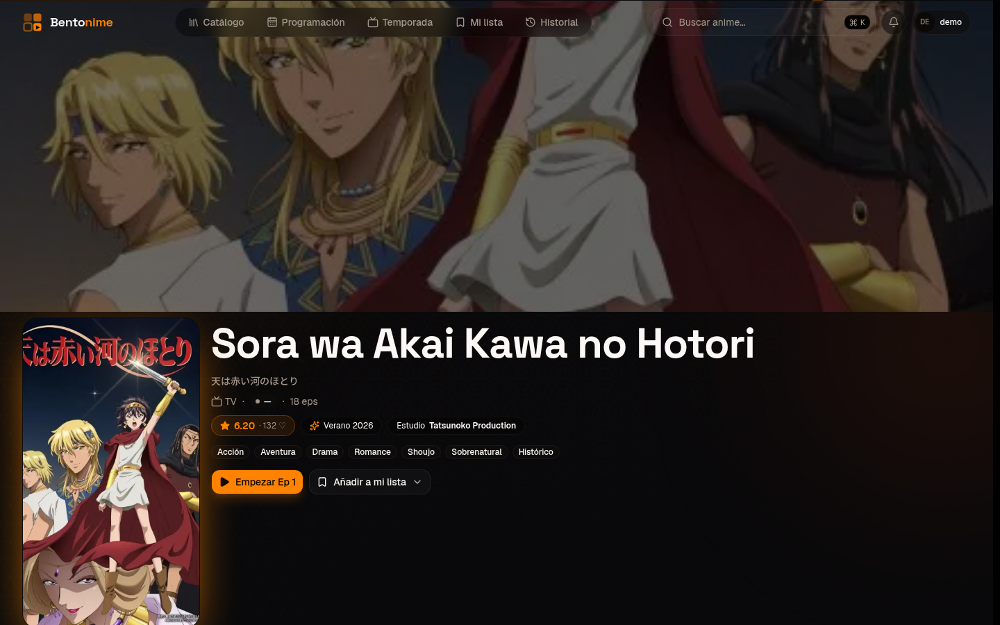
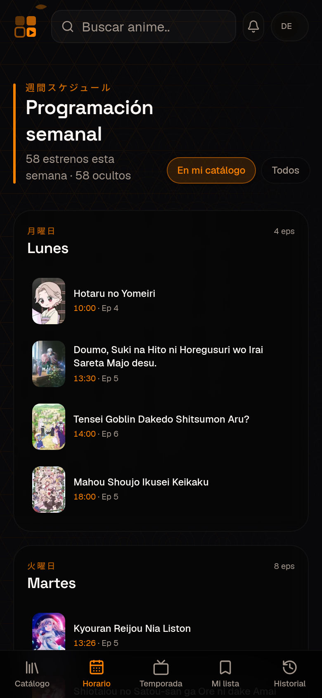
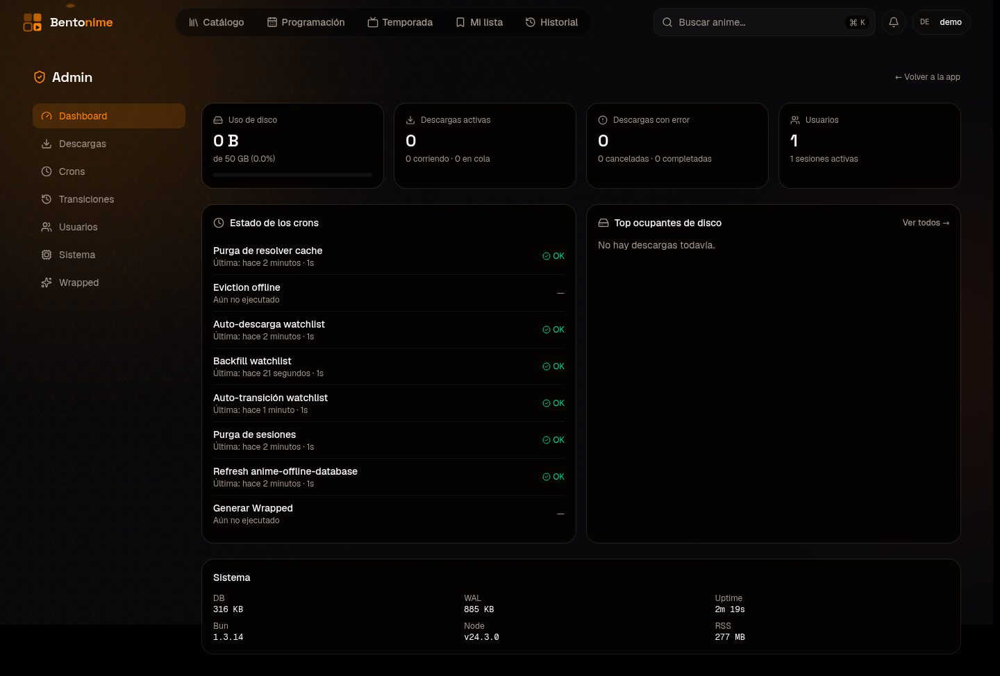
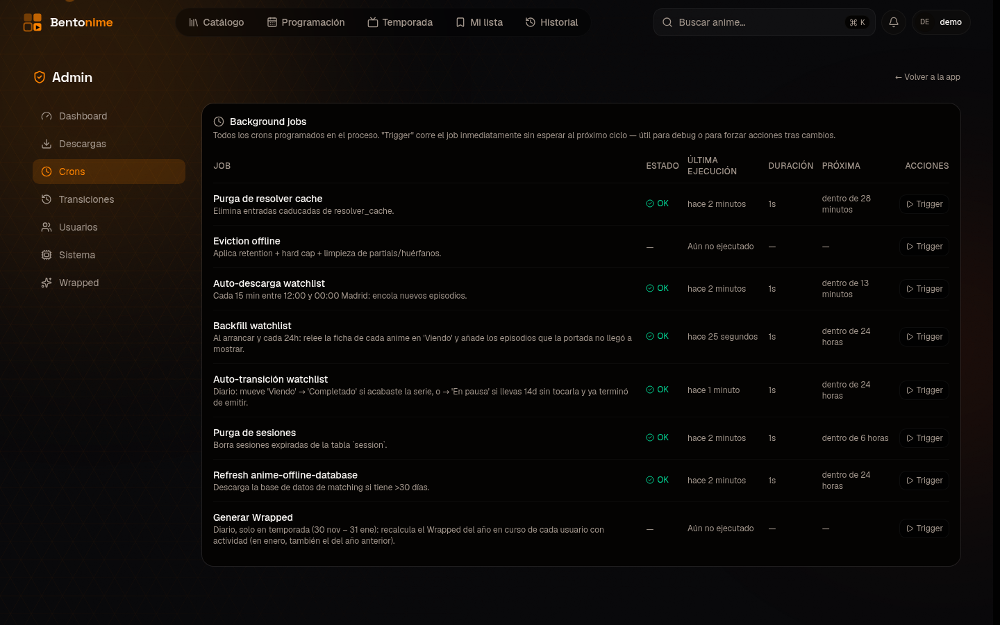
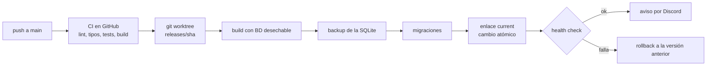

# Bentonime

App de streaming de anime en español que alojo en mi servidor casero para mí y un grupo de amigos. Login con Discord y lista blanca: no es un servicio público.

**El código no es público.** Depende de fuentes de vídeo de terceros y prefiero no publicarlo. Este repo explica qué hace, cómo está montada y qué decisiones tomé.

## Qué hace

- **Catálogo, búsqueda y programación semanal**, con datos de AniList (portadas, estudio, puntuación, géneros, horario de emisión).
- **Reproductor** con Vidstack: salto de opening y ending con AniSkip, miniaturas al pasar por la barra (sprites WebVTT generados con ffmpeg) y cambio automático de servidor si uno falla.
- **Descargas offline**: cola con prioridades y un worker en segundo plano. Los episodios de lo que estás viendo se descargan solos.
- **Mi lista** con cinco estados y transiciones automáticas (pasa a "Completado" al acabar, o a "En pausa" tras dos semanas sin tocarla).
- **PWA instalable** con notificaciones push cuando sale un episodio de algo que sigues.
- **Amigos** con código temporal y revocable, y permisos por persona y por dirección (qué ve cada uno de tu actividad).
- **Watch party**: salas sincronizadas por SSE, sin servidor aparte. El anfitrión manda y se corrige la deriva. Tiene chat y reacciones, y se puede invitar a gente sin cuenta con un enlace firmado que caduca.
- **Wrapped anual**, escondido como easter egg en diciembre y enero: estadísticas del año, "personalidad" y alma gemela entre tus amigos.
- **Panel de administración** solo para mí: disco, cola de descargas, crons, sesiones y usuarios.

| | |
|---|---|
|  |  |
|  |  |

## Stack

- **Next.js 16** (App Router, Turbopack) y React 19, TypeScript estricto
- **Bun** como runtime, con `bun:sqlite`
- **SQLite + Drizzle ORM**, migraciones escritas a mano
- Tailwind CSS v4 y shadcn/ui, TanStack Query, Vidstack, motion
- Auth propia: Discord OAuth (Arctic) y sesiones en SQLite
- Biome para lint y formato

## Seguridad

- **Lista blanca fail-closed**: si la lista de IDs permitidos está vacía, no entra nadie. Los intentos rechazados se registran.
- **Sesiones propias**: la cookie es un token aleatorio de 256 bits y en la base de datos solo se guarda su SHA-256. Un volcado de la tabla no sirve para entrar.
- **URLs de vídeo firmadas** con HMAC-SHA256 y caducidad de 4 horas.
- **Rate limit persistente** en SQLite (sobrevive a reinicios), con protección contra saltos de reloj.
- **El panel de admin devuelve 404**, no 403, a quien no es el owner: los demás usuarios ni saben que existe.
- **La app solo escucha en loopback** y sale a internet por Cloudflare Tunnel. No hay ningún puerto abierto para ella.

## Operación

**Crons observables.** Cada tarea en segundo plano (purgas, descargas automáticas, transiciones de la lista, refresco de datos, Wrapped) se define como un `CronJobDefinition`. Un envoltorio común guarda cada ejecución en una tabla `cron_run` (inicio, fin, estado, error, duración, próxima ejecución), con lo que el panel las muestra sin depender de la memoria del proceso. Desde el panel se pueden lanzar a mano, y hay un guard contra solapes.

**CI/CD con rollback.** Un push a `main` lanza GitHub Actions: lint, tipos, migraciones contra una BD vacía, tests y build. Luego un runner autoalojado en el servidor despliega por versiones:

Se guardan las tres últimas versiones. Las migraciones no se deshacen en un rollback, por eso hay backup de la base de datos justo antes.

**API para el bot de operaciones.** Unos endpoints `/api/ops/*` con token Bearer dejan que mi [bot de operaciones](https://github.com/IsDerky/asistente-ops) consulte quién está viendo algo, los episodios nuevos y la cola, y que encole descargas tras confirmar con un botón.

## Decisiones

- **SQLite y no Postgres**: una sola máquina y unos pocos usuarios. Backup con `sqlite3 .backup`, cero mantenimiento y búsqueda con FTS5.
- **Bun**: arranque rápido y SQLite nativo. A cambio, algunas librerías solo de Node no sirven y hay que comprobarlo antes de añadirlas.
- **Migraciones a mano**: los snapshots del generador se desfasaron, y escribirlas yo me asegura de que solo cambia lo que quiero.
- **No transcodificar**: las descargas ya vienen en AV1 a 1080p con poco bitrate, y la GPU integrada del servidor no codifica AV1. Se sirven tal cual.
- **Rutas de ficheros derivadas, nunca guardadas**: con el deploy por versiones, guardar rutas absolutas hacía "desaparecer" las descargas al rotar versiones. Ahora la ruta se calcula a partir del ID del episodio.

Forma parte de mi [homelab](https://github.com/IsDerky/homelab).

Las capturas son de una instancia de prueba con una base de datos vacía y un usuario de demo.
